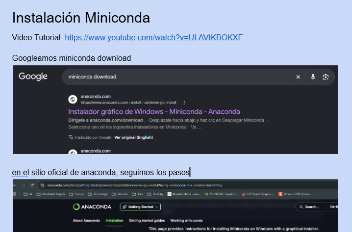
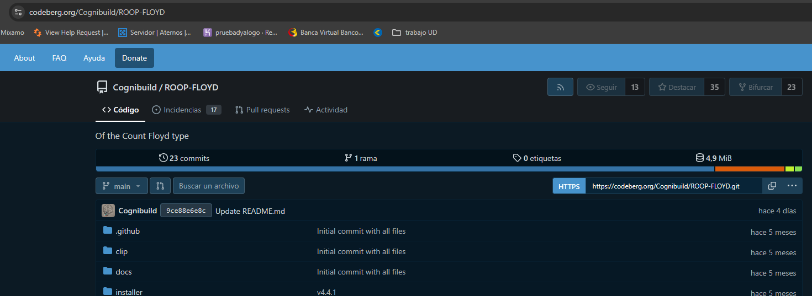
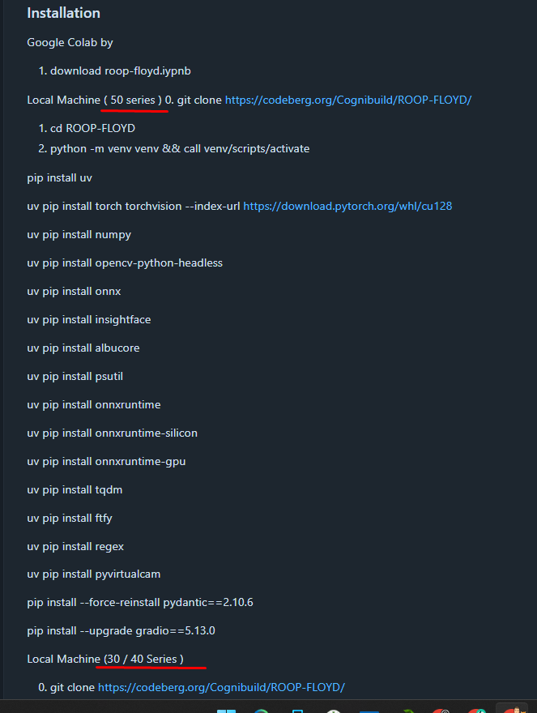
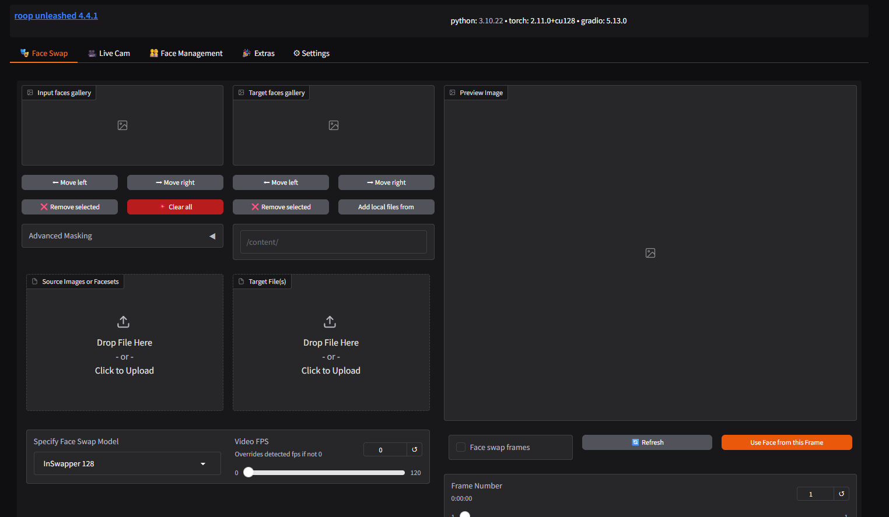

# 01 Face-swap / Intercambio de rostro

Video Tutorial 01 - Otro nombre

[https://www.youtube.com/watch?v=vkv5tJv_F6o](https://www.youtube.com/watch?v=vkv5tJv_F6o)

Video Tutorial 02

[https://www.youtube.com/watch?v=PQ46iwbFlMQ](https://www.youtube.com/watch?v=PQ46iwbFlMQ&t=1s)

# Instalación Roop-Floyd

## Requiere instalación de miniconda

[Instalacion miniconda](Instalacion_Miniconda.md)



## Repositorio codeberg como un github:

[https://codeberg.org/Cognibuild/ROOP-FLOYD](https://codeberg.org/Cognibuild/ROOP-FLOYD)



**README**

En la documentación del repo, se establecen distintas instalaciones conforme las generaciones de tarjetas gráficas NVIDIA GeForce RTX.



## Guía de instalación (Windows + NVIDIA)

Clonar repo


```bash
git clone https://codeberg.org/Cognibuild/ROOP-FLOYD
cd ROOP-FLOYD
```

Opción 1 env: Crear entorno virtual con python, la versión de python debe ser 3.10


```bash
# Crear Entorno virtual
python.exe -m venv env-roop
# Activar Entorno virtual
.\env-roop\Scripts\activate
```

Opción 2 env: Crear entorno virtual con conda


```bash
conda create --prefix ./env-root python=3.10
```

Instalar librerías para (serie 50) 


```bash
pip install uv
uv pip install torch torchvision --index-url https://download.pytorch.org/whl/cu128
uv pip install numpy opencv-python-headless onnx insightface albucore psutil onnxruntime-gpu tqdm ftfy regex pyvirtualcam

pip install --force-reinstall pydantic==2.10.6
pip install --upgrade gradio==5.13.0
```

Instalar librerías para (serie 30-40) 

```bash
conda install -c nvidia cudatoolkit=11.8 -y
pip install -r requirements.txt
pip install onnxruntime-directml
pip install --upgrade gradio --force
pip install --upgrade fastapi pydantic --force
pip install "numpy<2.0"
```

### Ejecutar


```bash
python run.py
```


