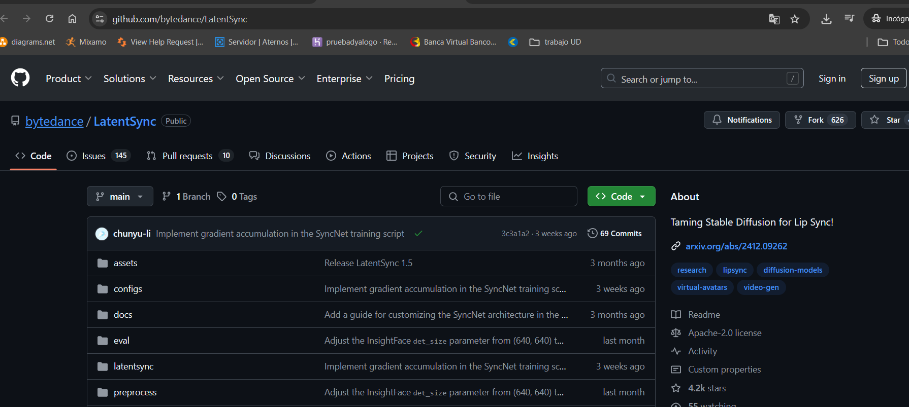
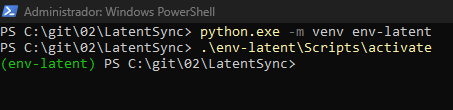
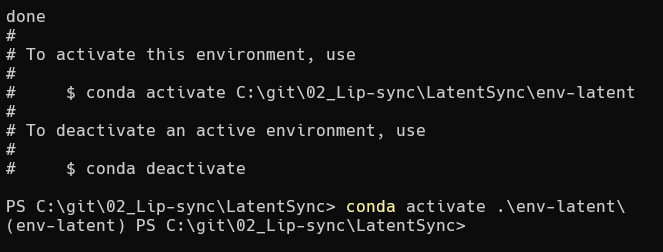
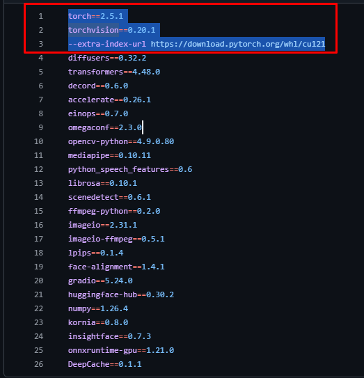
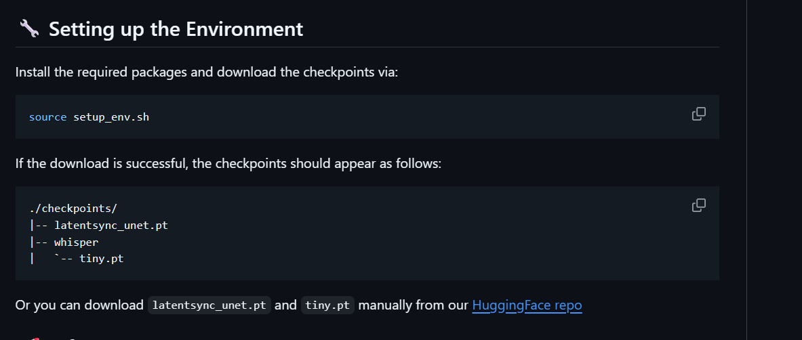
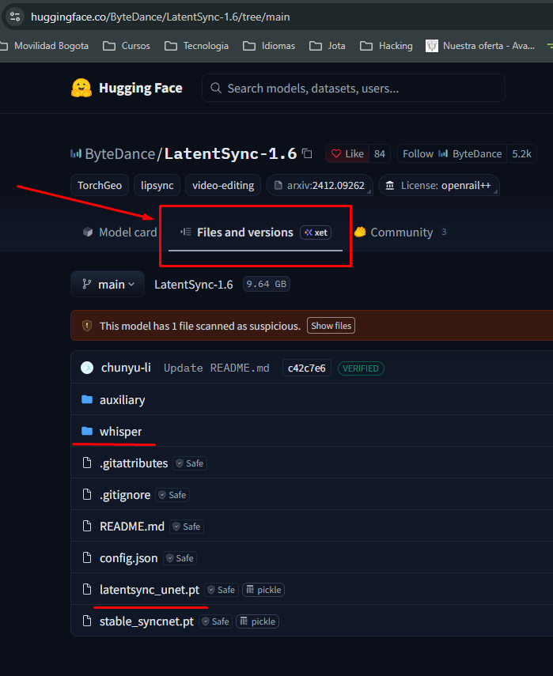
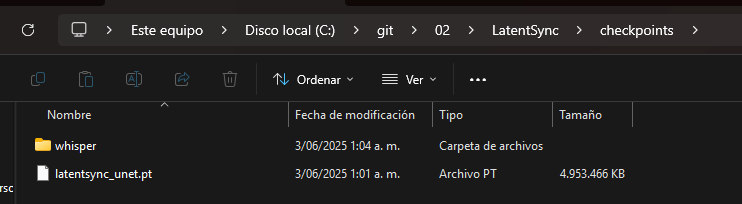
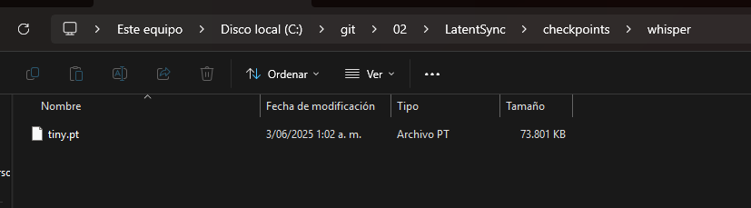
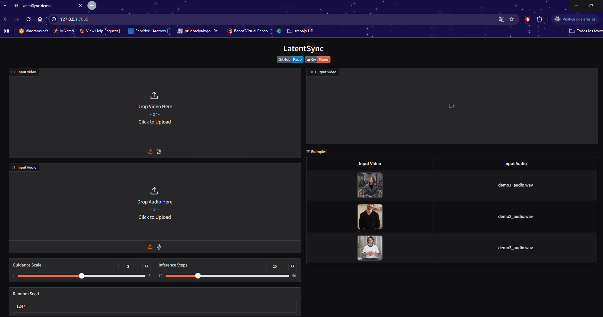

# 02 Lip-sync / Sincronización labial

**Video Tutorial:** [https://www.youtube.com/watch?v=XIQnV583Yac](https://www.youtube.com/watch?v=XIQnV583Yac)

**Repo github:**  [https://github.com/bytedance/LatentSync](https://github.com/bytedance/LatentSync)



# Instalación

Clonar Repo


```bash
git clone https://github.com/bytedance/LatentSync.git
```

Ingresar a carpeta


```bash
cd latentSync
```

***Opción 1  env***: Crear entorno  y Activar  (python=3.10.13)


```bash
# Crear entorno virtual
python.exe -m venv env-latent

# Activar entorno virtual
.\env-latent\Scripts\activate
```



***Opción 2 env***: Crear entorno virtual con conda


```bash
conda create --prefix ./env-latent python=3.10.13
# Activar
conda activate .\env-latent\
```



Instalar y actualizar  pip  solo si realizar la opción ***(Opción 1  env) ***


```bash
python.exe -m pip install --upgrade pip
```


**NOTA (Solo Para RTX 5070 TI):**

Se debe modificar el requirements.txt debió a la tarjeta gráfica del computador en el que se está instalando.




```bash
--extra-index-url https:*//download.pytorch.org/whl/cu128*
torch==2.7.0
torchvision==0.22.0
torchaudio==2.7.0
```

Instalar Requerimientos


```bash
pip install -r requirements.txt
```

Luego puedes ejecutar el archivo setup_env.sh

o hacerlo de forma manual; se debe crear una carpeta y descargar los siguiente archivo del link de HuggingFace repo.



En la pestaña de Files and Version encontramos los archivos



Se debe crear la carpeta checkpoints

Las carpetas estarán de la siguiente manera.

checkpoints



checkpoints/whisper



### Ejecutar


```bash
python gradio_app.py
```

[http://127.0.0.1:7860/](http://127.0.0.1:7860/)


