# 03 Reenactment / Recreaciones

**Video resultado:**
[https://www.youtube.com/watch?v=SnKEcVQ4m3k](https://www.youtube.com/watch?v=SnKEcVQ4m3k)

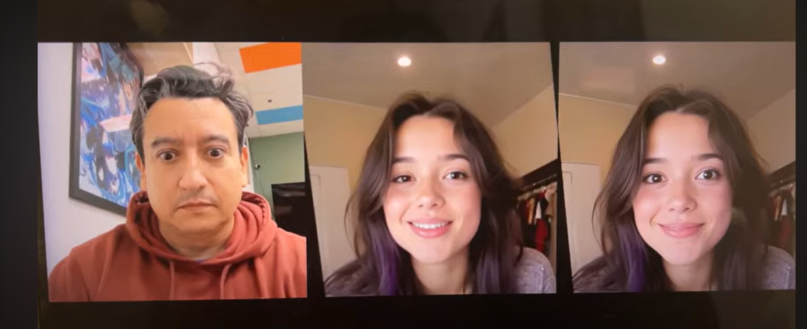

**Video tutorial Instalación en  linux:** 
[https://www.youtube.com/watch?v=SenfNiDKbCM&t=324s](https://www.youtube.com/watch?v=SenfNiDKbCM&t=324s)

**Video tutorial de instalación en Windows:** [https://www.youtube.com/watch?v=361oR2Yc9EE&t=1481s](https://www.youtube.com/watch?v=361oR2Yc9EE&t=1481s)

# Instalación

Repo GIT:

[https://github.com/KwaiVGI/LivePortrait](https://github.com/KwaiVGI/LivePortrait)

Clonamos repo


```bash
git clone https://github.com/KwaiVGI/LivePortrait
cd LivePortrait
```

Creamos entorno virtual


```bash
# create env using conda
conda create --prefix ./env-livePortrait python=3.10

# **Activamos** env
conda activate .\env-livePortrait\
```

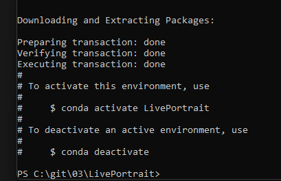

Configurar repositorios de conda


```bash
conda config --add channels conda-forge
conda config --set channel_priority strict
conda install ffmpeg
```

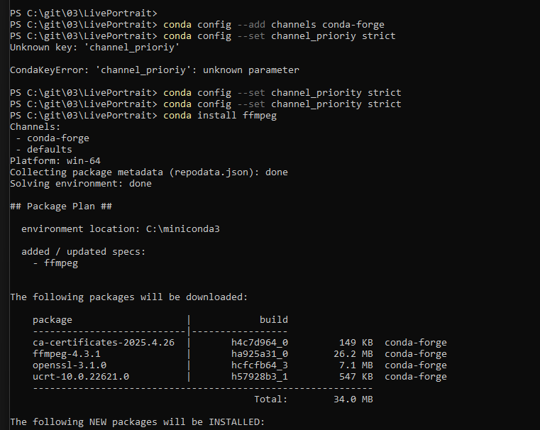

Validar versión de CUDA


```bash
nvcc -V # example versions: 11.1, 11.8, 12.1, etc.
```

## Instalación para CUDA 11.8

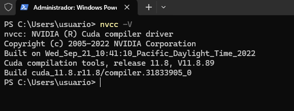

**Para CUDA 11.8**


```bash
pip install torch==2.3.0 torchvision==0.18.0 torchaudio==2.3.0 --index-url https://download.pytorch.org/whl/cu118
```

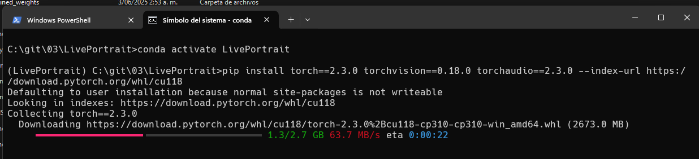

Instalar los requerimientos del repo


```bash
pip install -r requirements.txt
```

Ajustes librerías


```bash
pip uninstall gradio gradio_client -y
pip install gradio==4.44.1 gradio-client==1.3.0
pip install pydantic==2.10.6
```

## Instalación para CUDA 12.8

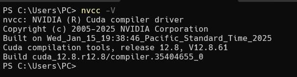

**Para CUDA 12.8**


```bash
pip install torch torchvision torchaudio --index-url https:*//download.pytorch.org/whl/cu128*
```

Ajustes librerías


```bash
pip uninstall gradio gradio_client -y
pip install gradio==4.43.0 gradio_client==1.3.0
pip install --force-reinstall "pydantic==2.10.6"
```

Instalar los requerimientos del repo


```bash
pip install -r requirements.txt
```

## Descargar modelos

Descarga los modelos compartidos desde Google Drive y copia en la carpeta **pretrained_weights **ubicada en el directorio raíz del repositorio.

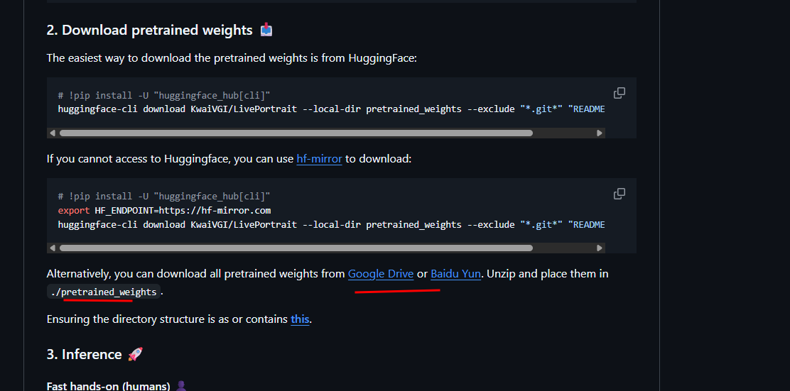

Descargando de Google Drive

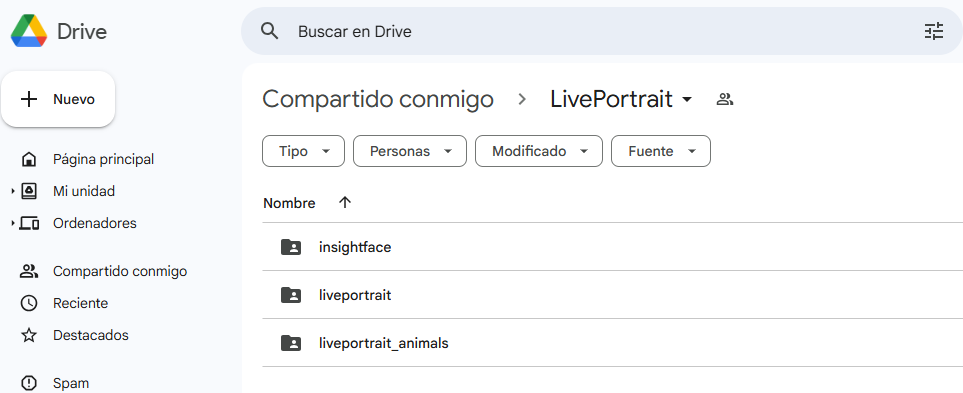

Pegando en la carpeta

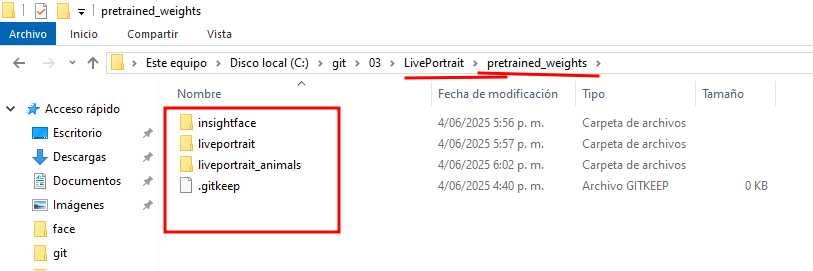

# Ejecutar App


```bash
python .\app.py --share
```

# Ejecutar desde Terminal


```bash
# source input is an image
python inference.py -s assets/examples/source/s9.jpg -d assets/examples/driving/d0.mp4
```

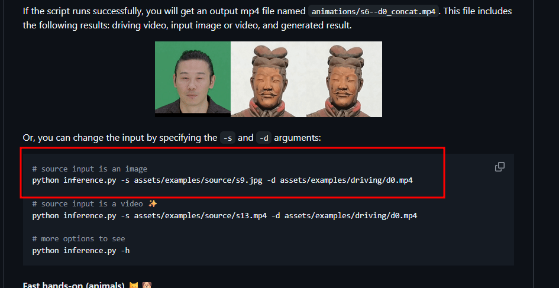

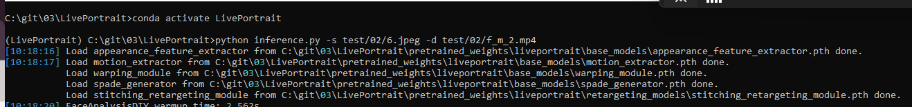
