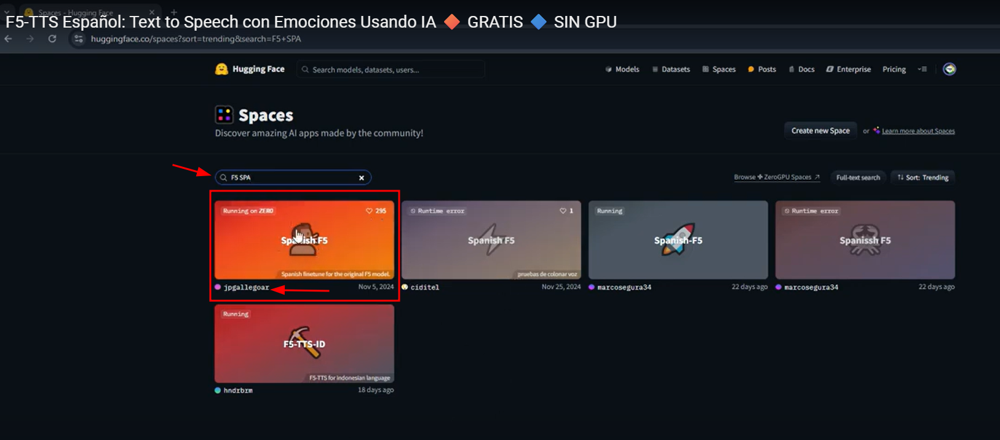
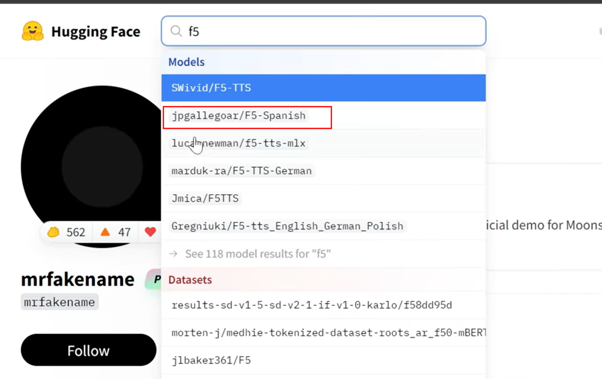
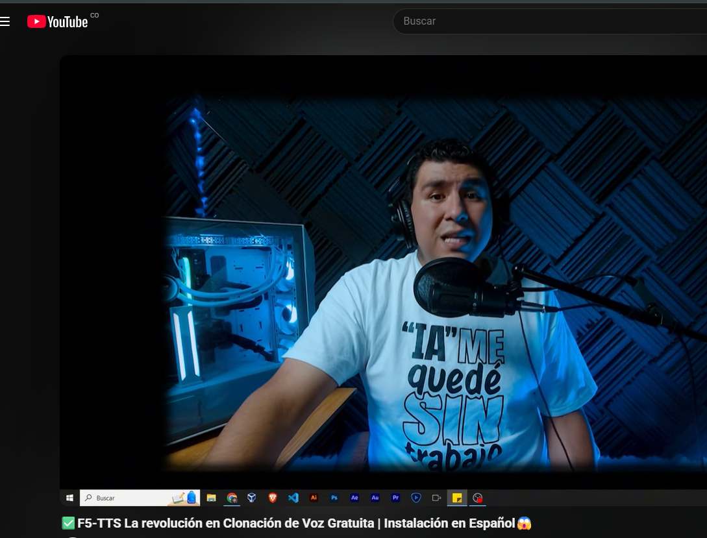
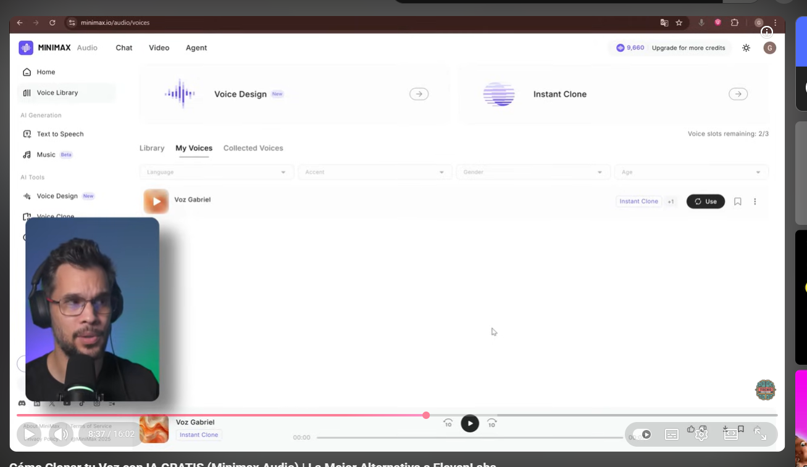
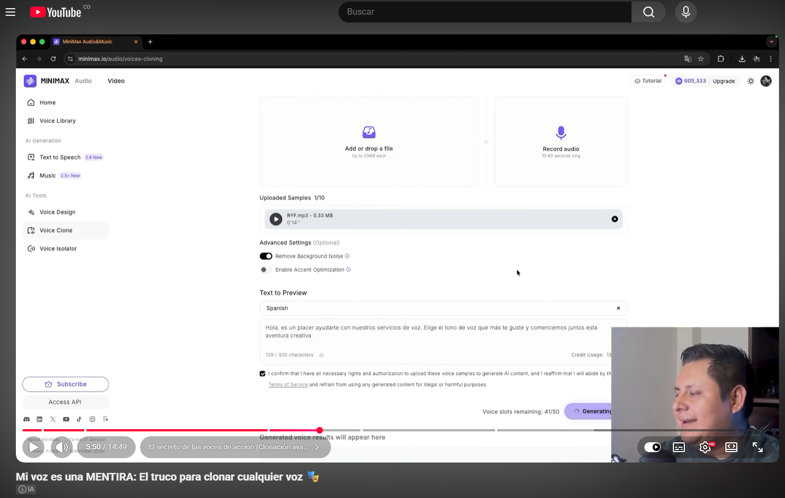

# 04-Text To Speech (TTS)

Video Tutorial 1: [https://www.youtube.com/watch?v=q5whPZsD9IQ](https://www.youtube.com/watch?v=q5whPZsD9IQ)

Video Tutorial 2:  [https://www.youtube.com/watch?v=pvlYD8-7HW8](https://www.youtube.com/watch?v=pvlYD8-7HW8)

Video Tutorial 3:  Uso del modelo únicamente: [https://www.youtube.com/watch?v=l8cI9o_e-gA](https://www.youtube.com/watch?v=l8cI9o_e-gA)

# Repositorios

## Repo original de voz en inglés

[https://github.com/SWivid/F5-TTS](https://github.com/SWivid/F5-TTS)

## Repo de voz en español

[https://github.com/jpgallegoar/Spanish-F5](https://github.com/jpgallegoar/Spanish-F5)

# Alternativa - Minimax

link: [https://www.minimax.io/audio](https://www.minimax.io/audio)

[https://www.youtube.com/watch?v=DZahD-zMljw](https://www.youtube.com/watch?v=DZahD-zMljw)

[https://www.youtube.com/watch?v=m-45W9Wb-8s](https://www.youtube.com/watch?v=m-45W9Wb-8s)

