# 2.Voice

# 1) Instalación cambiador de voz

Ingresando al repositorio  [https://github.com/w-okada/voice-changer](https://github.com/w-okada/voice-changer)

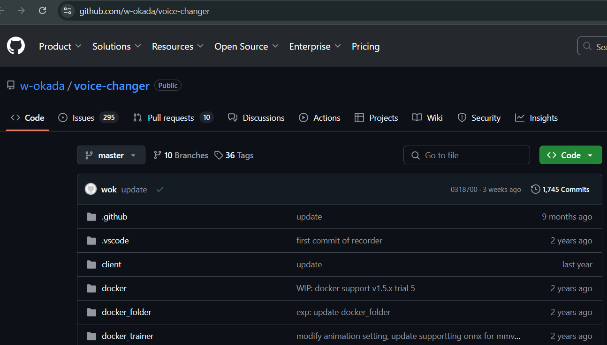

Encontramos el link para descargamos el vccliente

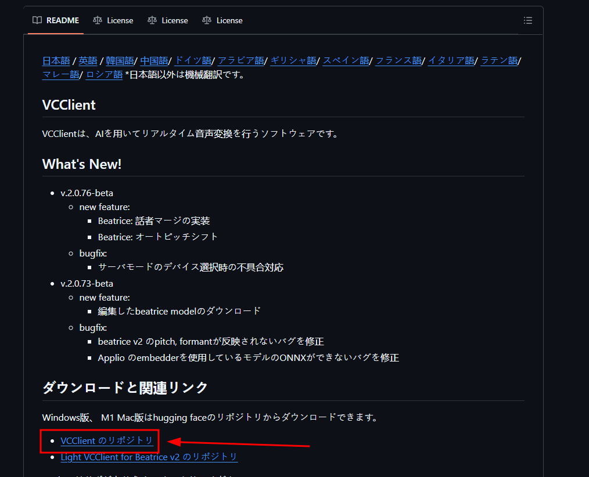

Nos direcciona a este sitio [https://huggingface.co/wok000/vcclient000/tree/main](https://huggingface.co/wok000/vcclient000/tree/main)

Descargamos la versión más alta.

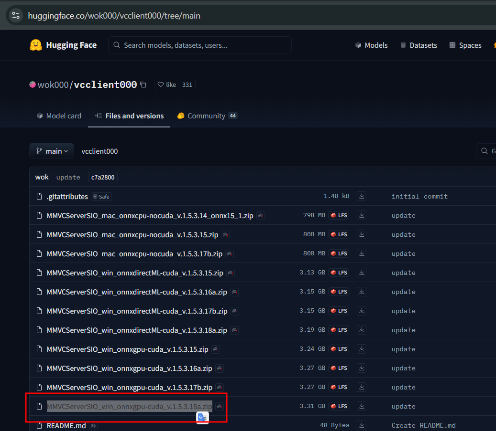

Este link nos direcciona a [https://huggingface.co/wok000/vcclient000/blob/main/MMVCServerSIO_win_onnxgpu-cuda_v.1.5.3.18a.zip](https://huggingface.co/wok000/vcclient000/blob/main/MMVCServerSIO_win_onnxgpu-cuda_v.1.5.3.18a.zip)  para descargar

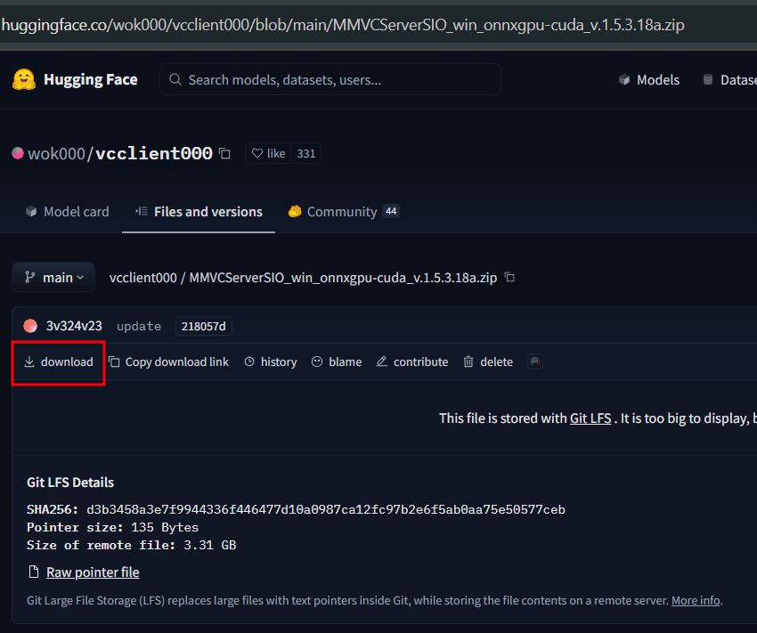

1 Descargamos en el escritorio

2 Descomprimimos

3 Ejecutamos como administrador el programa

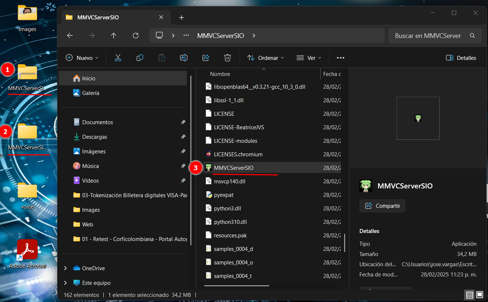

Se abren 2 ventanas las cuales no se deben cerrar, trabajaremos con la ventana número 2

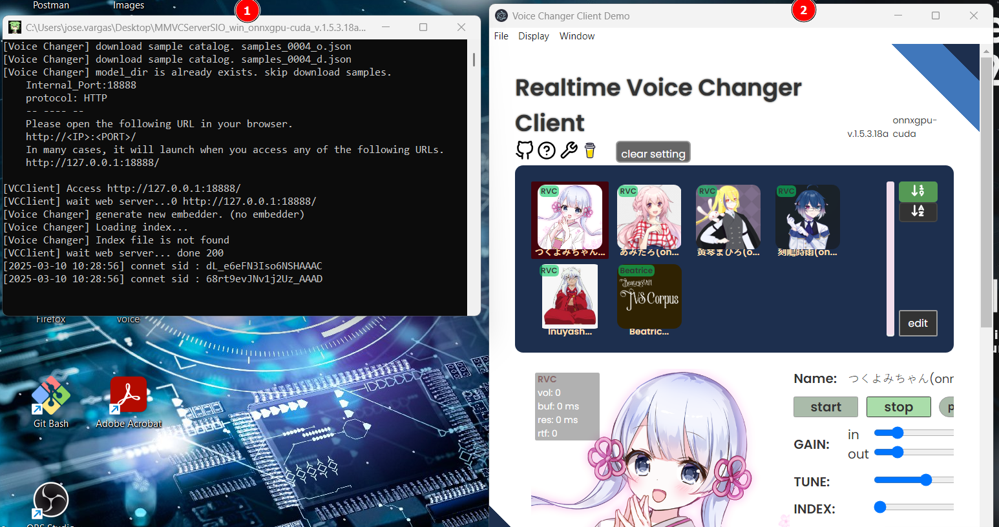

## 1.1 Configurar entradas y salidas de audio

En la **input **seleccionamos el micrófono, con el que se cuenta.

**Output **debemos seleccionar el cable virtual “*que debe estar instalado*”.

Para fines de pruebas en **monitor **seleccionamos los audífonos o parlantes para escuchar la voz del personaje.

Pero para los ejercicios una vez testeado, dejar en none.

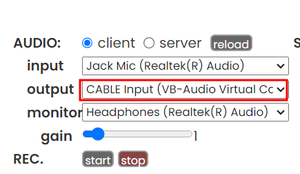

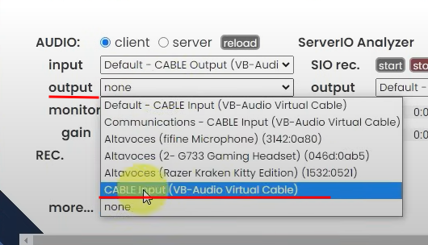

## 1.2 Configurar Ganancia de entrada y salida

La **GAIN  “ganancia” de entradas “in”**  si el micrófono suena muy suave se le puede subir para ganar audio de entrada.

para **GAIN OUT se recomienda en 2. **

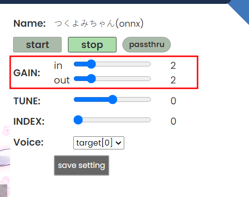

## 1.3 Configurar Tune

Modifica el tono de la voz

Voz femenina o de niños de 10 en adelante.  10 a 18

voz masculinas y gruesas -10 a -18

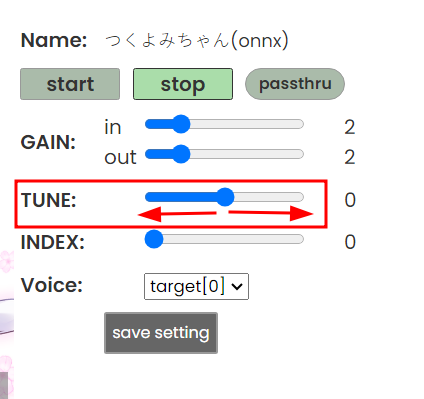

## 1.4 Configurar INDEX

Es la terminación vocal de los personajes, no todos los modelos tiene

0,5 es ideal para que no suene robótico

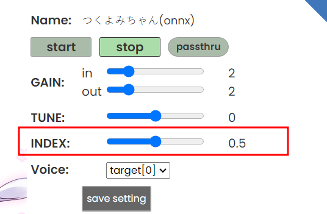

## 1.5 Configurar supresores de ruido

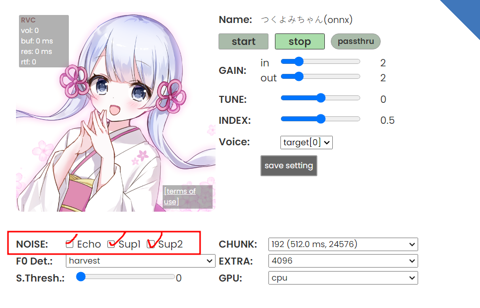

Echo : suprime el eco

Sup1: suprime el ruido

Sup2: suprime los pop

## 1.6 Configura Método de conversión

Se recomienda el **creve** y si no funciona bien como segunda opción **harvest**

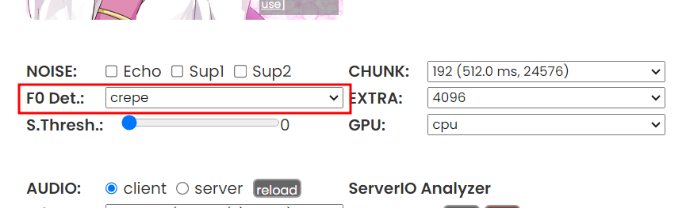

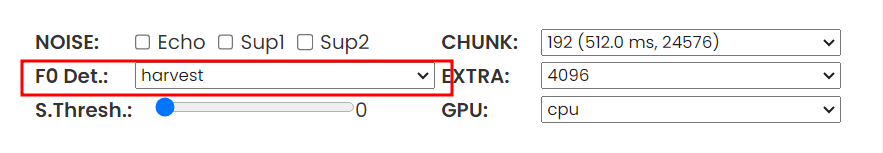

## 1.7 Configura delay compuerta de ruido

Lo que hace es que cuando dejamos de hablar, cierra el micrófono y deja un retardo, lo recomendado es dejarlo en** 0.**

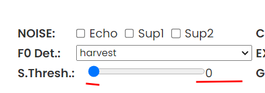

## 1.8 Configura Fragmentos CHUNK

Son los fragmentos de información que le enviamos a la IA, depende de las capacidades de la tarjeta gráfica con la que cuente el pc.

Con 6 GB se puede dejar en **320**

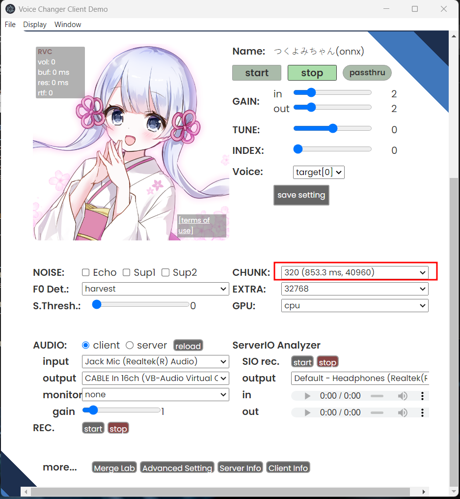

## 1.9 Configura EXTRA

Si tienes una buena PC podría ser 131072

pero en el tuto 32768

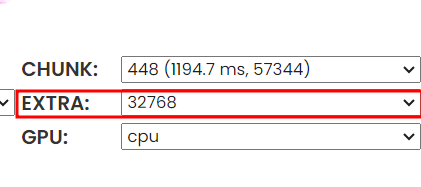

## 1.10 Configura GPU

Debe salir su tarjeta gráfica, en mi caso este pc no tiene tarjeta grafica por eso sale cpu.

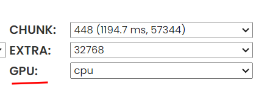

# 2) Repositorio de Voces

[https://voice-models.com/](https://voice-models.com/)

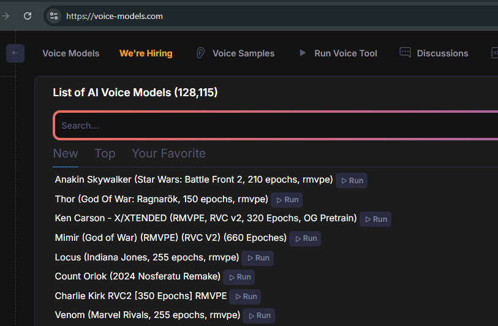

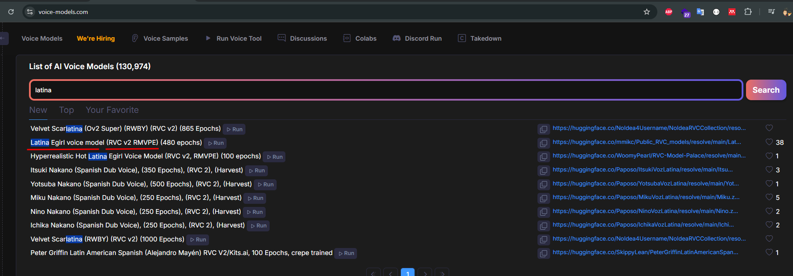

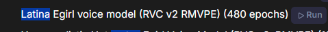

Servidor de discor

[https://discord.com/invite/aihub](https://discord.com/invite/aihub)

Un **epoch **implica un ciclo completo del conjunto de datos de entrenamiento que se compone de lotes e iteraciones del conjunto de datos, y el número de epoch necesarios para que un modelo se ejecute de manera eficiente se basa en los datos en sí y en el objetivo del modelo.

# 3) Instalación Cable virtual

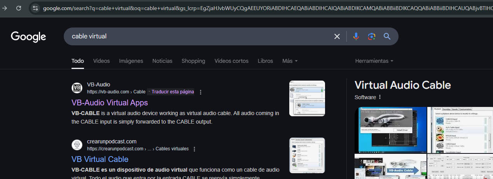

Ingresamos a la pagina [https://vb-audio.com/Cable/](https://vb-audio.com/Cable/)

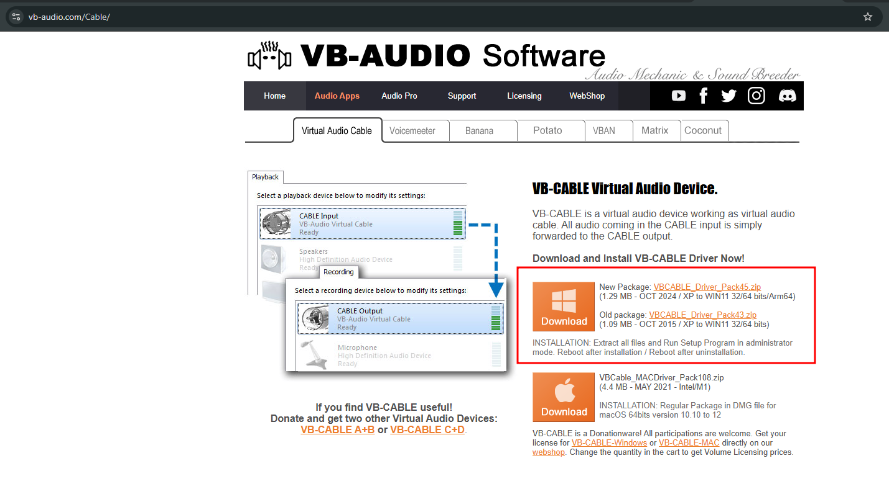

Ejecutamos como administrador.

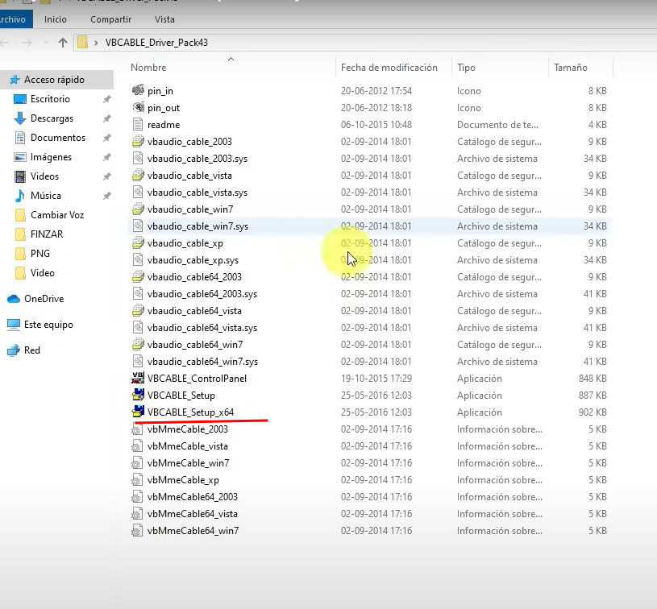

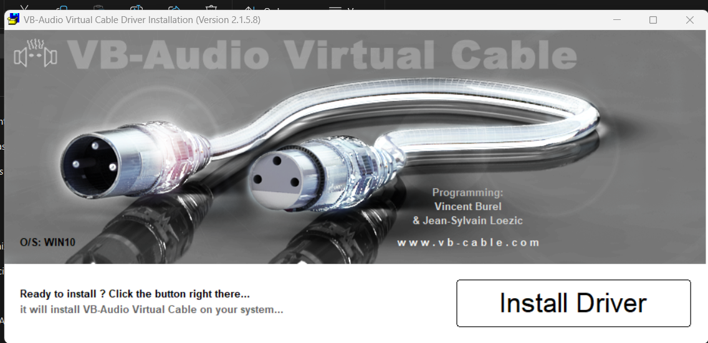

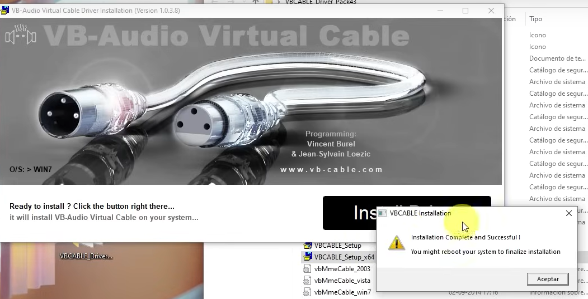

## 3.1 Configurar output en cambiador de voces

Como ya tenemos instalado el cable virtual, en el voice change en la sección de AUDIO en la opción output seleccionamos el cable virtual

# Fuentes

[https://www.youtube.com/watch?v=M8FzJlKSHTQ](https://www.youtube.com/watch?v=M8FzJlKSHTQ)

[https://www.youtube.com/watch?v=iDbqspsWqZc](https://www.youtube.com/watch?v=iDbqspsWqZc)

# Alternativas

[https://www.youtube.com/watch?v=hcOMsLuOoCc](https://www.youtube.com/watch?v=hcOMsLuOoCc)

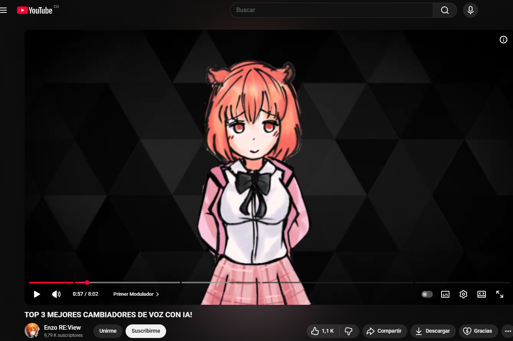

## Puesto #3

[https://www.youtube.com/watch?v=q4i68Uxcv8E](https://www.youtube.com/watch?v=q4i68Uxcv8E)

El principal problema es configurar la entrada y salida de audio si no son las misma el programa no inicia.

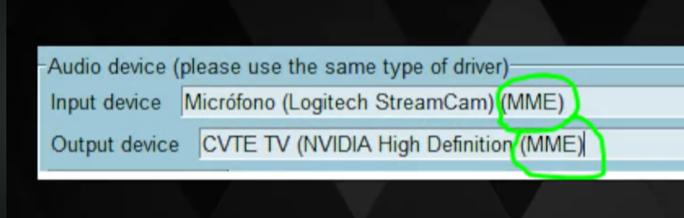

Ejemplo algunos dispositivos no tiene la misma terminación

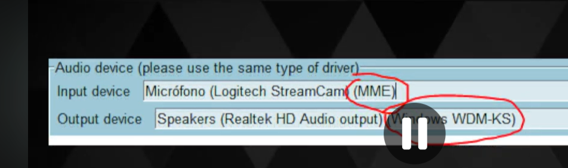

Repo github

[https://github.com/RVC-Project/Retrieval-based-Voice-Conversion-WebUI](https://github.com/RVC-Project/Retrieval-based-Voice-Conversion-WebUI)

Video tutorial

[https://www.youtube.com/watch?v=TZ2odHFHOp0](https://www.youtube.com/watch?v=TZ2odHFHOp0)

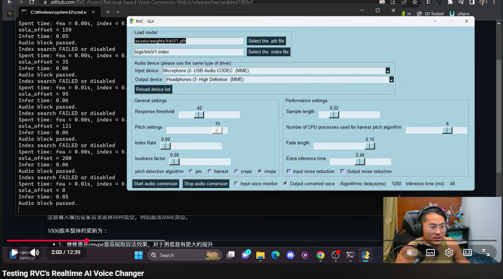

Configuración Inicial

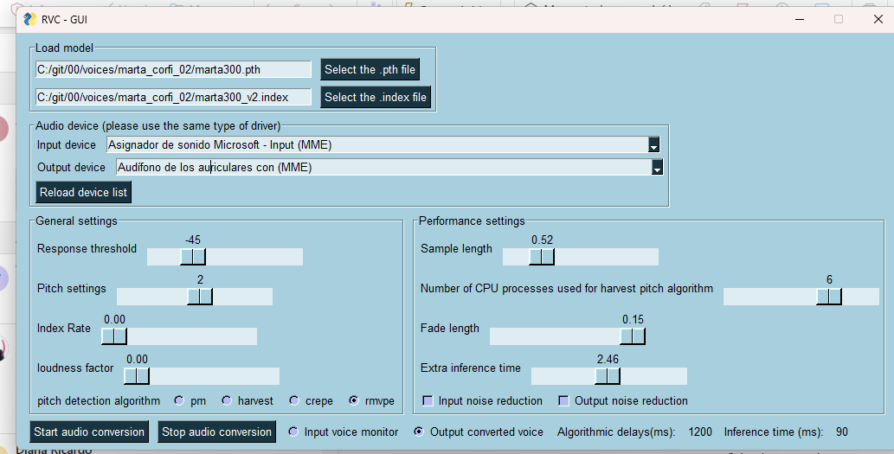
