# Crear voice model RVC

La Conversión de Voz Basada en Recuperación (RVC) es una tecnología innovadora que transforma o clona voces mediante métodos como la extracción de características y la síntesis. Con los modelos y aplicaciones de voz de RVC, los usuarios pueden modificar fácilmente una voz de origen para que suene como la voz de destino.

Los modelos RVC, o conversión de voz basada en recuperación, son una tecnología de vanguardia que transforma voces. Utiliza técnicas avanzadas para aprovechar las cualidades únicas de una voz y aplicarlas a otra. Esta tecnología busca lograr que las voces suenen realmente convincentes, lo cual es fundamental para cualquier proyecto de audio.

Obtener el audio del objetivo.

ya sea de un video, transformar el video a audio y solo dejar las partes donde el objetivo habla.

Preferencias:

Alta calidad en el audio

Eliminar ruidos

voces de otras personas

ecos

Distorsión

ya que la IA utilizará todos estos sonidos para su entrenamiento.

# 1. Audio de dataSet

## 1.1. Convertir mp4 a mp3

VLC  media player

https://www.videolan.org/vlc/

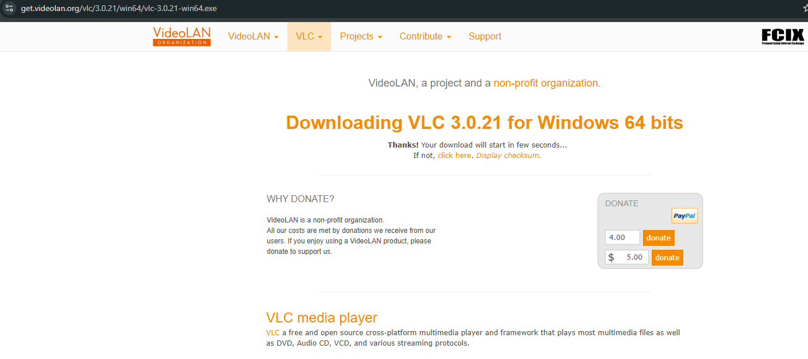

Click en Medio

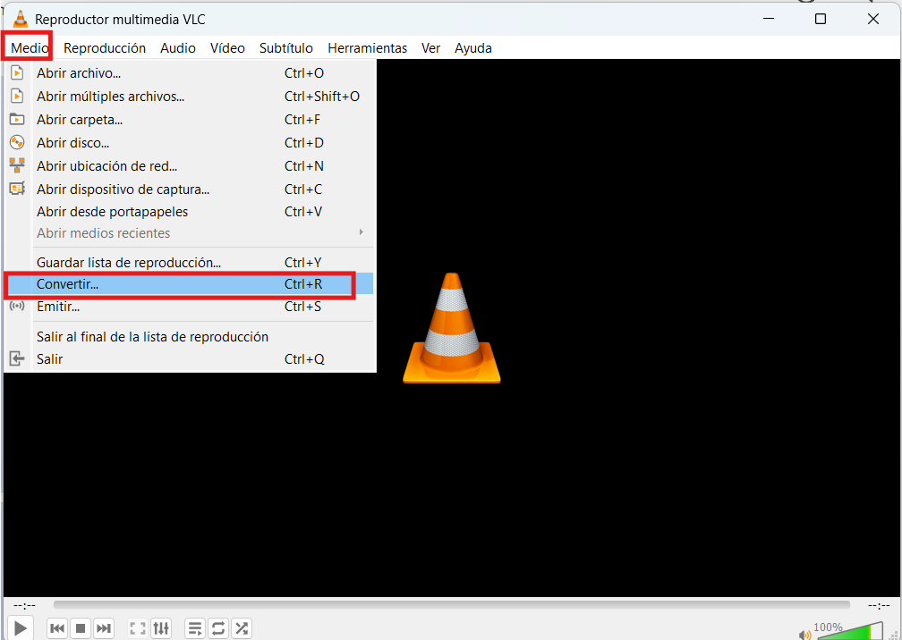

Click en **Añadir **y buscamos el video, luego click en **Convertir/Guardar**

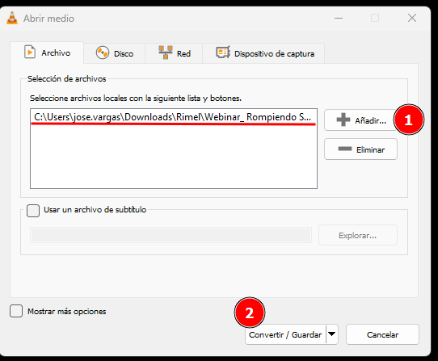

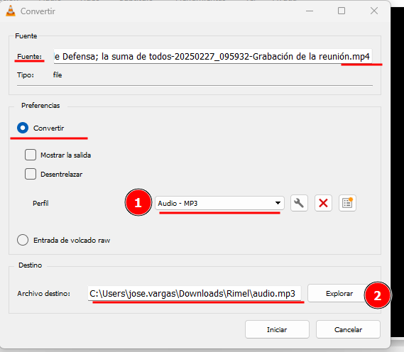

Este será el avances del proceso de conversión

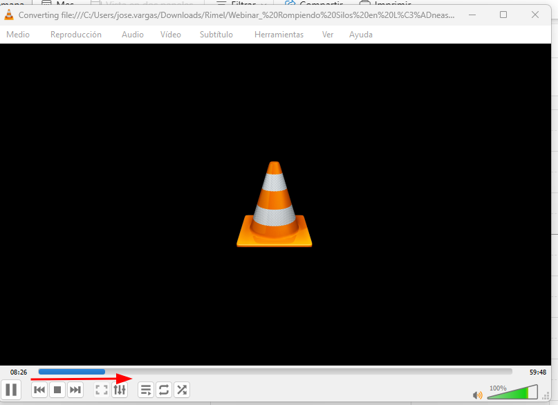

## 1.2. Recortar Audio - Audacity (obtener un audio solo del objetivo)

**Audacity** (licencia libre) [https://www.audacityteam.org/download/](https://www.audacityteam.org/download/)

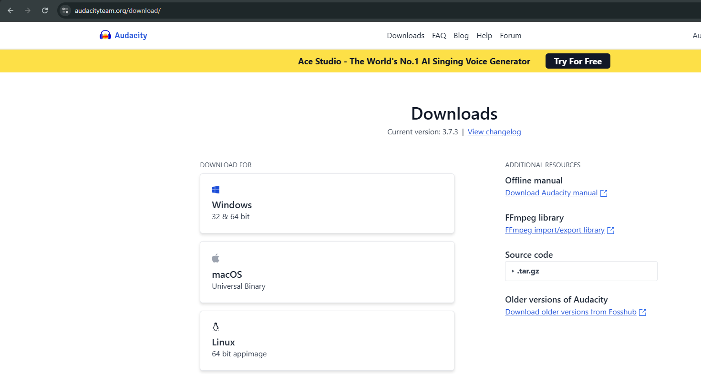

Obtener de 10 a 20 minutos de audio del objetivo.

Con el primero obtuve 18 minutos de rimel

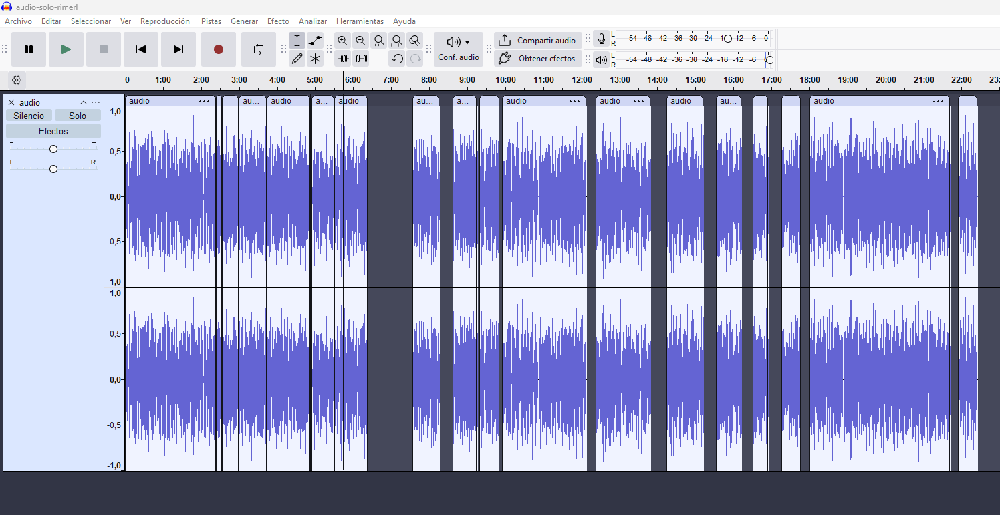

**Para separar el audio **

**Editar / bloques de audio / Dividir **

**atajo :  Ctr + i **

## Tratamiento de audi - [Normaliza] Graduar o igualar audios diferente a un solo volumen

[https://www.youtube.com/watch?v=DP-nFqJTJnQ](https://www.youtube.com/watch?v=DP-nFqJTJnQ)

## Tratamiento de audi - Ordenar audios en uno solo

[https://www.youtube.com/watch?v=wdiAO60F9lU](https://www.youtube.com/watch?v=wdiAO60F9lU)

## Tratamiento de audi - Quitar musica de fondo

[https://www.soundverse.ai/stem-splitter-ai](https://www.soundverse.ai/stem-splitter-ai)

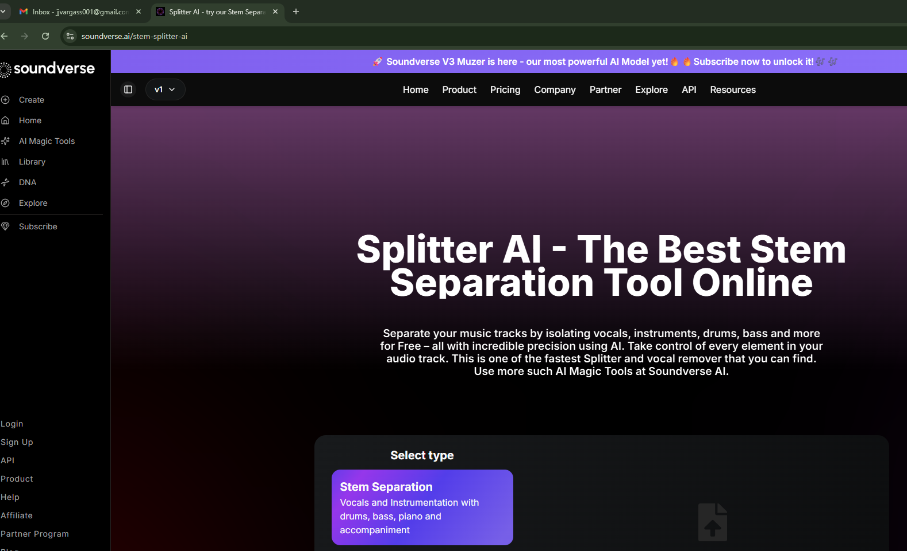

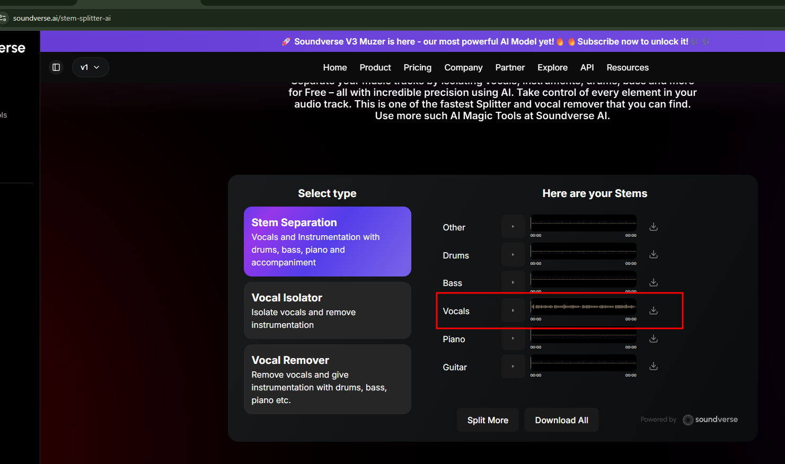

Fuente tutorial:  [https://www.youtube.com/watch?v=m5ZQVoJa3uQ](https://www.youtube.com/watch?v=m5ZQVoJa3uQ)

## 1.3. Recortar Audio en fragmentos de 10 a 15 segundos

Esto se hace con una herramientas llamada **Free Batch Music Splitter**

[https://www.fosshub.com/Free-Batch-Music-Splitter.html](https://www.fosshub.com/Free-Batch-Music-Splitter.html)

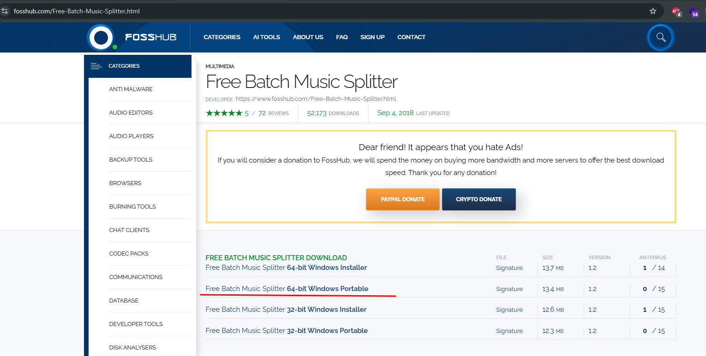

Usar el programa portable, creamos una carpeta para el objetivo

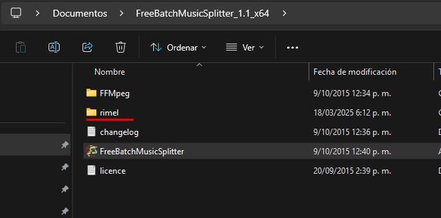

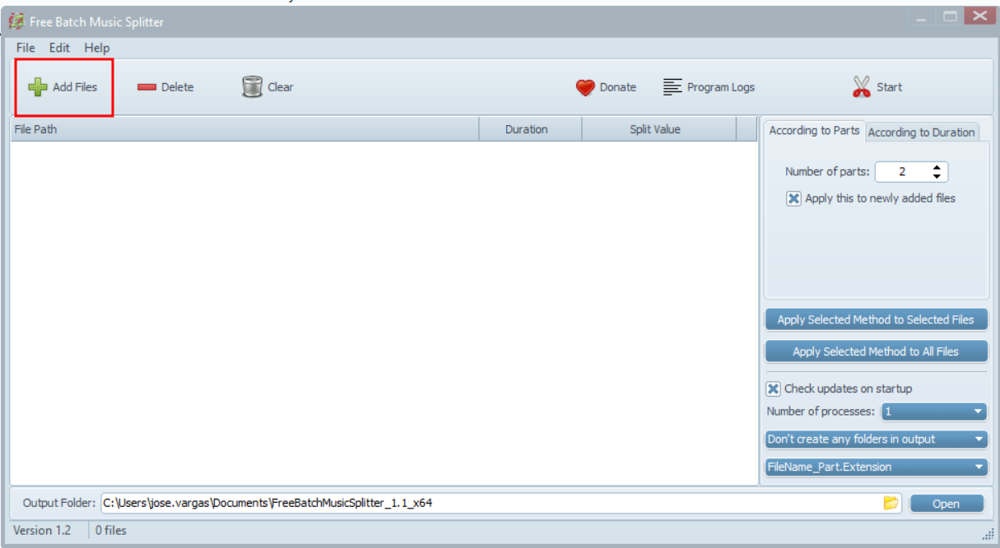

Click a add File y seleccionamos el archivo mp3 del audio objetivo.

Luego click en According to Duration y especificamos 10 en el campo sconds

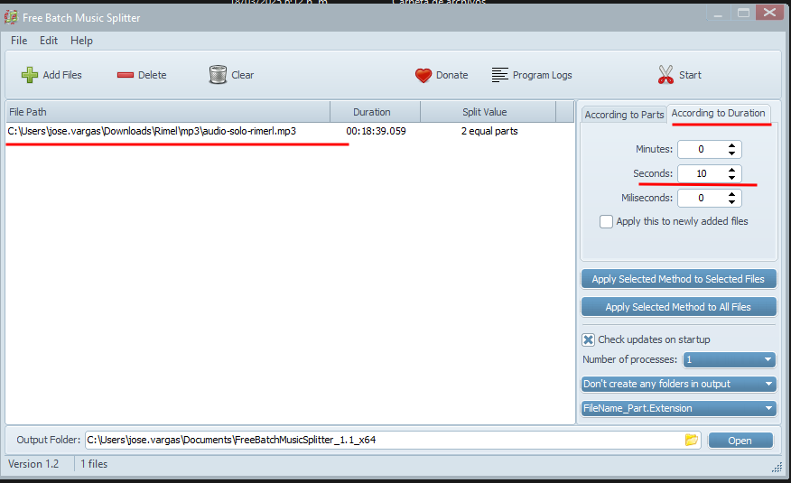

Click en Apply Selected Method to All File

En el campo final la ruta de salida.

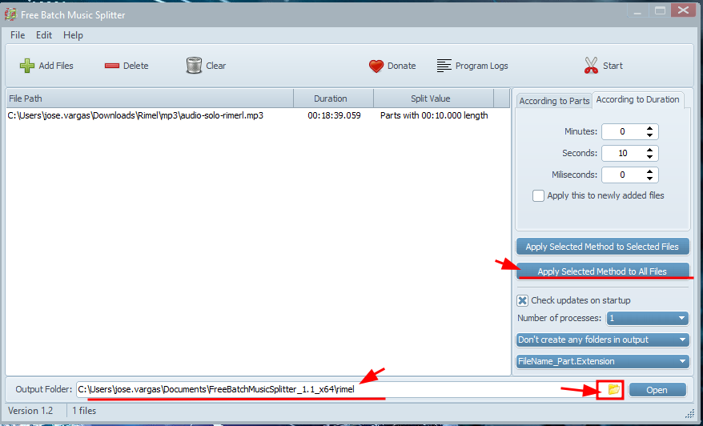

Click en Start

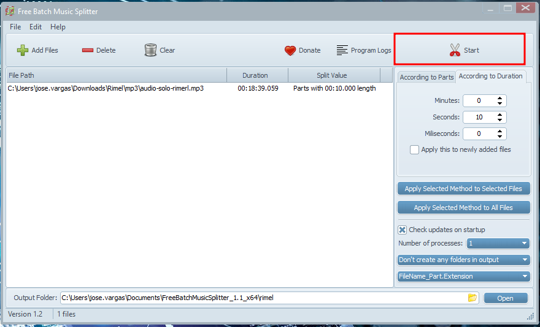

Procesando los recortes

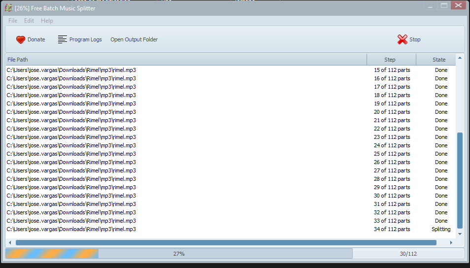

Al dirigirnos a la carpeta emos estos archivos

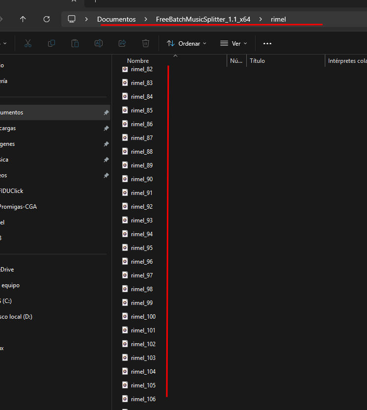

## 1.4. Crear DataSet

Nos dirigimos a la carpeta donde están los fragmentos de audio separados,

Los seleccionamos todos

Click derecho / Enviar A / Carpeta Comprimida Zip

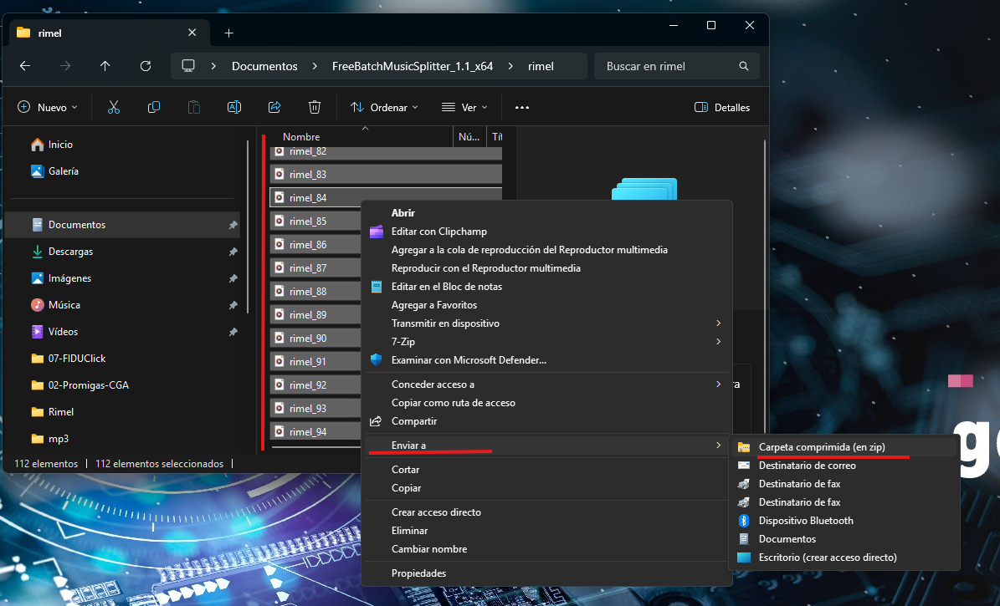

Le damos el nombre ejemplo: **rimelDataset**

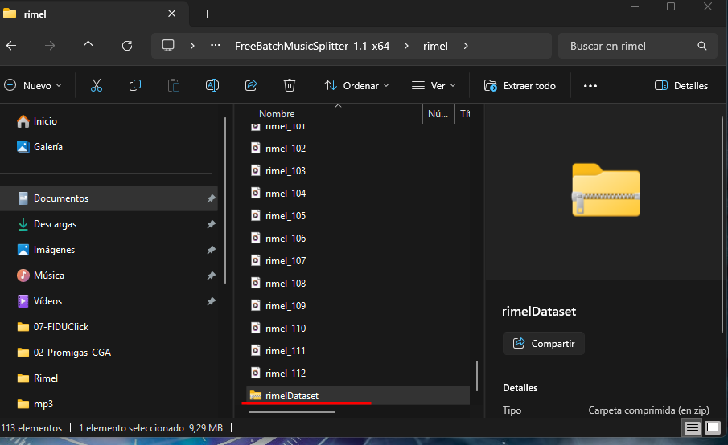

Con este dataset entrenas a la Inteligencia artificial.

# 2. Entrenamiento de IA

crear un voice model rvc

## 2.1 crear cuenta de google

## 2.2 Google Colab

Colab es un servicio alojado de Jupyter Notebook que no requiere configuración y ofrece acceso gratuito a recursos informáticos, como GPU y TPU. Colab es especialmente adecuado para el aprendizaje automático, la ciencia de datos y la educación.

Google Colab es un servicio de Jupyter Notebooks, una plataforma web de Google que permite a los usuarios escribir y ejecutar código Python, principalmente para tareas de aprendizaje automático, ciencia de datos y educación, sin necesidad de configuración local. Ofrece acceso gratuito a recursos de cómputo como GPUs y TPUs, facilitando el trabajo con grandes conjuntos de datos y modelos complejos.

[https://colab.research.google.com/drive/1XIPCP9ken63S7M6b5ui1b36Cs17sP-NS?usp=sharing](https://colab.research.google.com/drive/1XIPCP9ken63S7M6b5ui1b36Cs17sP-NS?usp=sharing)

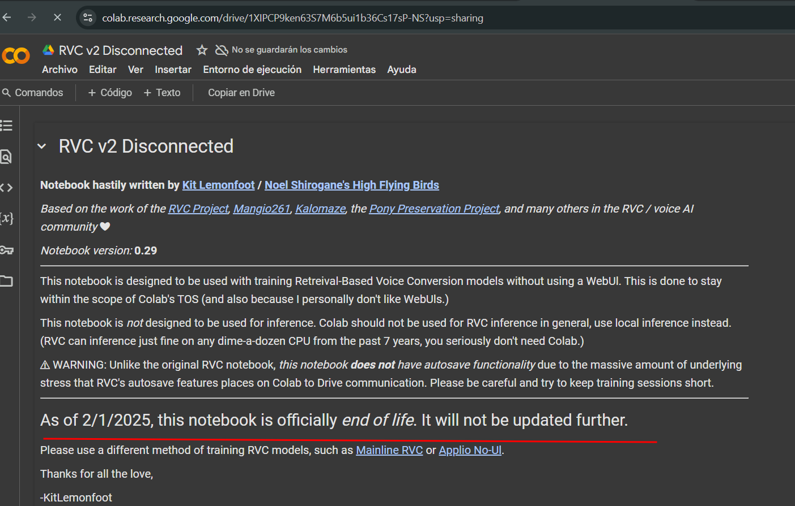

## Solución del error:

[https://github.com/RVC-Project/Retrieval-based-Voice-Conversion-WebUI/issues/2676](https://github.com/RVC-Project/Retrieval-based-Voice-Conversion-WebUI/issues/2676)

[https://github.com/RVC-Project/Retrieval-based-Voice-Conversion-WebUI/issues/2676](https://github.com/RVC-Project/Retrieval-based-Voice-Conversion-WebUI/issues/2676)


```bash
!pip install faiss-cpu
!sudo apt-get update
!sudo apt-get install python3.10 python3.10-distutils python3.10-dev -y
!sudo update-alternatives --install "/usr/bin/python3" python3 "/usr/bin/python3.10" 1
!sudo update-alternatives --set python3 /usr/bin/python3.10
!sudo apt-get install python3-pip -y
```

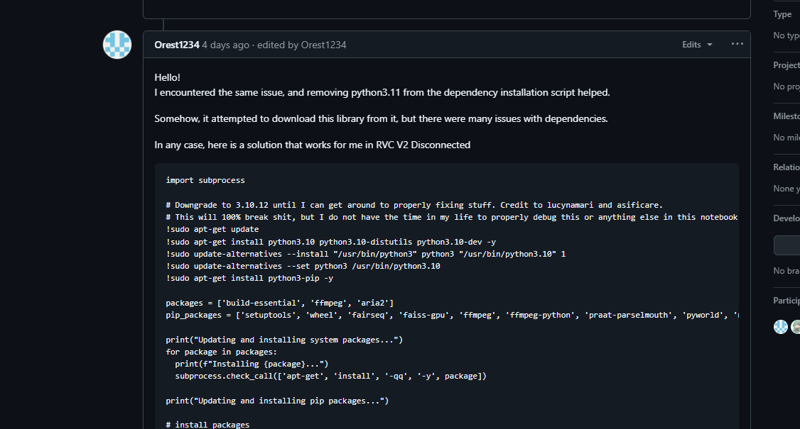

## Solución del error index training.

En una celda antes de ejecutar el *Index Training*, instala el paquete FAISS compatible con tu entorno (CPU o GPU):


```bash
!pip install faiss-gpu
```

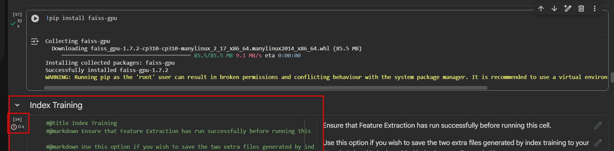

Están bloqueando los repos Colab, se debe hacer de forma local

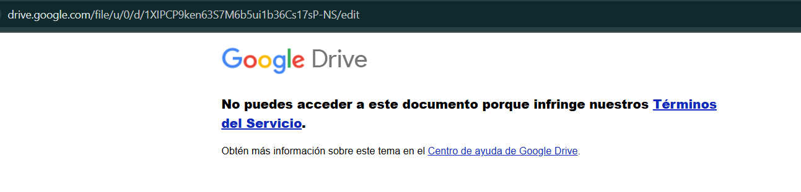

link repo fuentes colab: [https://github.com/MedicDoesStuff/RVC-Disconnected/tree/main?tab=readme-ov-file](https://github.com/MedicDoesStuff/RVC-Disconnected/tree/main?tab=readme-ov-file)

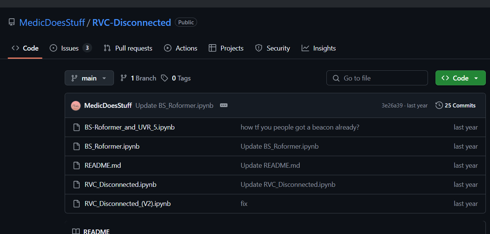

# Fuentes

## Crear DataSet

[https://www.youtube.com/watch?v=zh5yExGeXb0](https://www.youtube.com/watch?v=zh5yExGeXb0)

## Google Colab

Es la actualización del video de crear DataSet pero con el colab actualizado.

[https://www.youtube.com/watch?v=PcUZCAU_MCE](https://www.youtube.com/watch?v=PcUZCAU_MCE)
