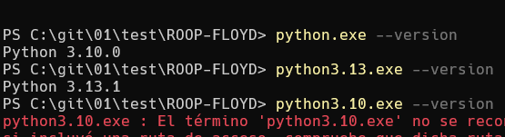
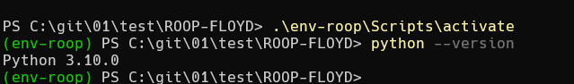
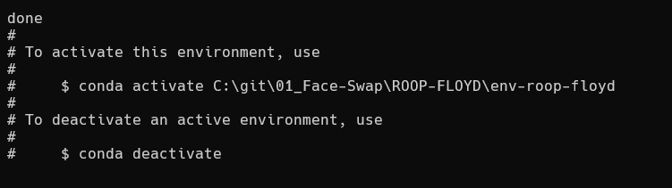
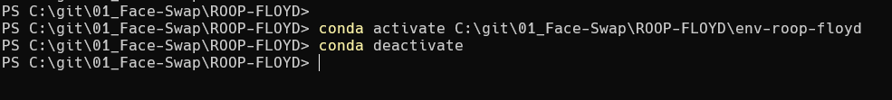
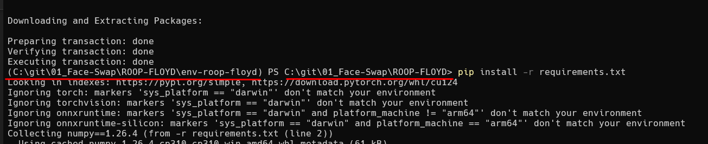

# Crear entorno virtual Python Linux


```bash
# Crear Entorno virtual python 
└─$ python3 -m venv env-mitmproxy2swagger

# Activar entorno virtual python 
└─$ source env-mitmproxy2swagger/bin/activate
```

# Crear entorno virtual Python Windows

Tengo dos versiones en el equipo


```bash
PS C:\git\01\test\ROOP-FLOYD> python.exe --version
Python 3.10.0
PS C:\git\01\test\ROOP-FLOYD> python3.13.exe --version
Python 3.13.1
```




Crear entorno y Activar

```bash
# Crear Entorno virtual python 
python.exe -m venv env-roop

# Activar entorno virtual python 
.\env-roop\Scripts\activate
```




# Crear entorno virtual Conda

Este comando crea el env en la carpeta donde está el binario de conda.


```bash
conda create -n env-nombre python=3.10
```

Para que el env quede en el directorio actual o en el directorio del proyecto se realiza con el comando **--prefix**


```bash
conda create --prefix ./env-nombre python=3.10
```



## Configuraciones de Prompt

Para habilitar Prompt


```bash
conda init powershell
```

Para solucionar Prompt con ruta absoluta


```bash
conda config --set env_prompt '({name}) '
```

**Activar en entorno**


```bash
conda activate C:\git\01_Face-**Swap**\ROOP-FLOYD\env-roop-floyd
```

**Desactivar el entorno**


```bash
conda deactivate
```

# Solución a Prompt

## No Prompt de entorno virtual en la Terminal

Cuando iniciamos el entorno virtual no se visualiza el prompt del entorno



Para habilitar Prompt


```bash
conda init powershell
```

## Prompt con la ruta absoluta



Para solucionar


```bash
conda config --set env_prompt '({name}) '
```
