# Instalación Miniconda

Video Tutorial: [https://www.youtube.com/watch?v=ULAVtKBOKXE](https://www.youtube.com/watch?v=ULAVtKBOKXE)

Googleamos miniconda download

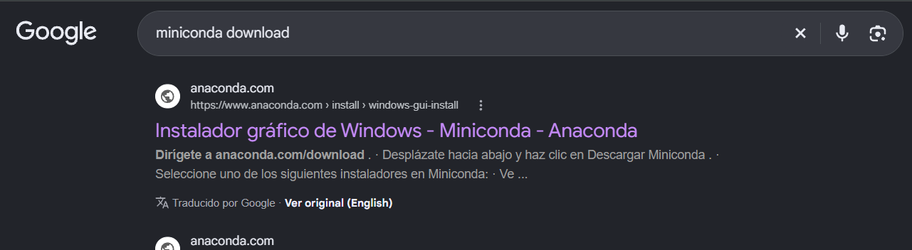

En el sitio oficial de anaconda, seguimos los pasos.

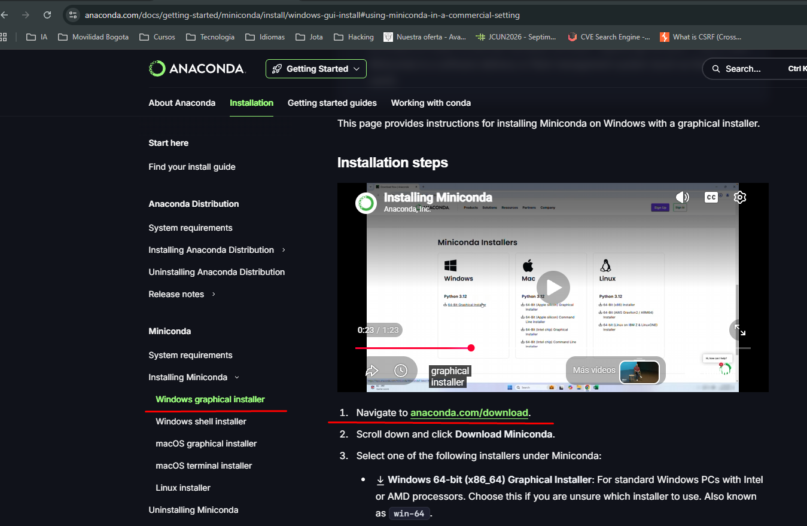

Ingresamos a [https://www.anaconda.com/download](https://www.anaconda.com/download)

En la parte inferior se encuentra el link para descargar.

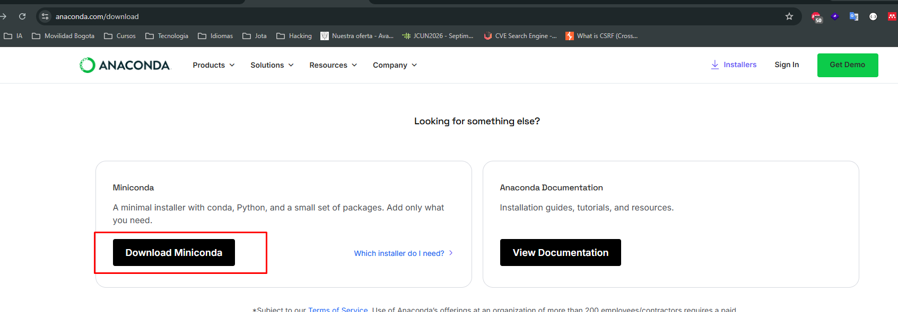

[https://www.anaconda.com/download/success?reg=skipped-miniconda](https://www.anaconda.com/download/success?reg=skipped-miniconda)

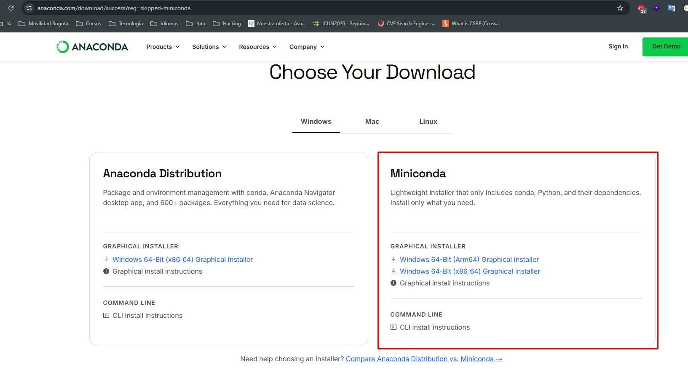

Ejecutamos como administrador

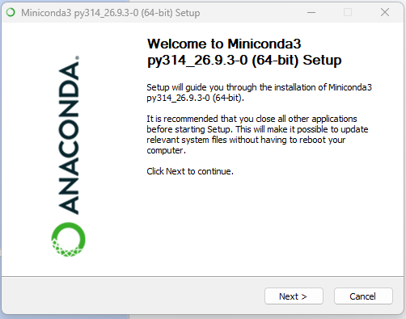

Click en I Agree

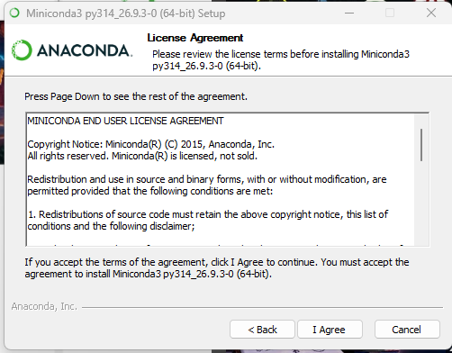

Click Next

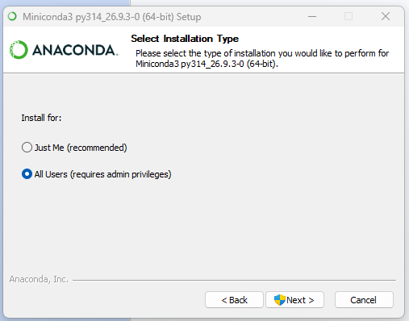

Minimizamos la ruta:

Original :  C:\ProgramData\miniconda3

Corta: C:\miniconda3

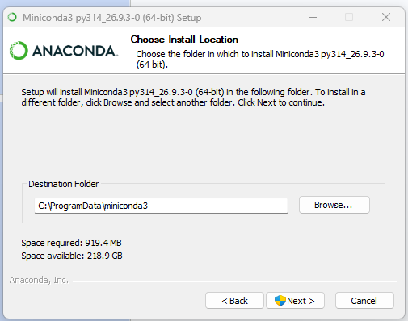

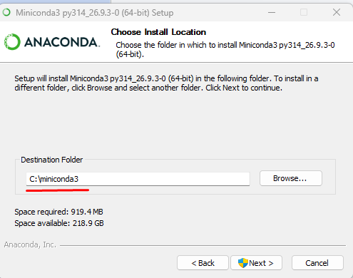

Solo seleccionamos la primera casilla como en la imagen.**Importante**

Click Install

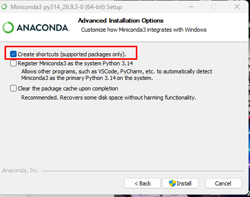

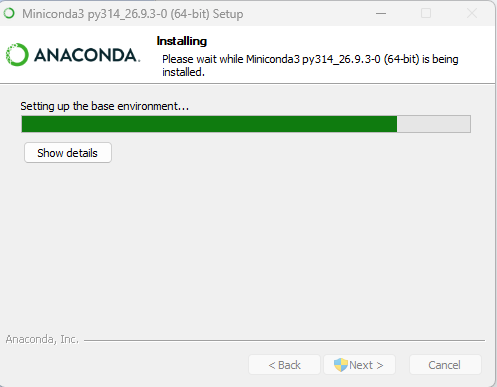

# Agregar miniconda al PATH

La ruta es:   C:\miniconda3\condabin

En variables del sistema

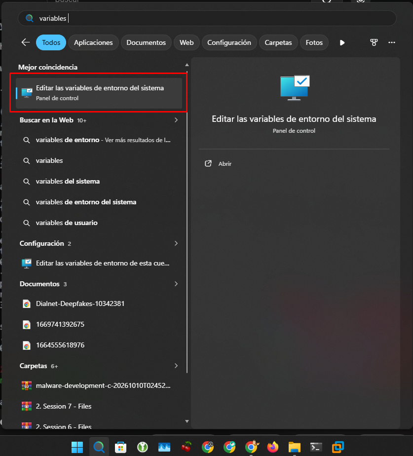

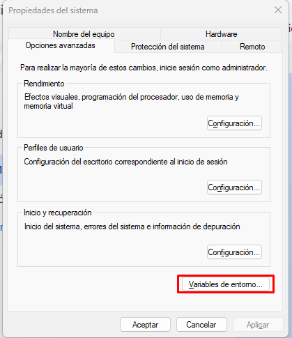

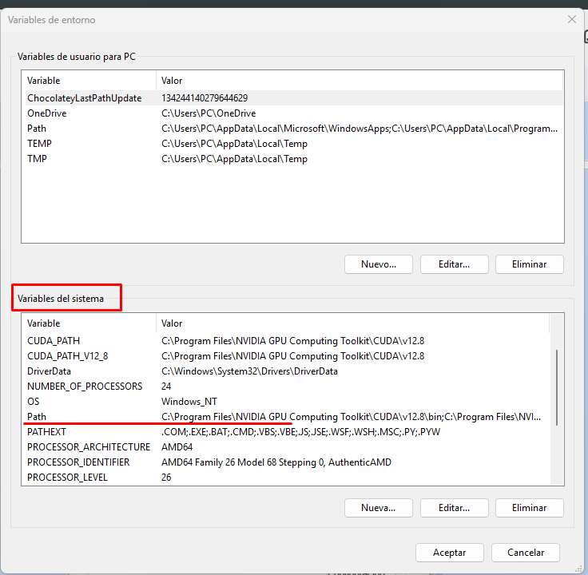

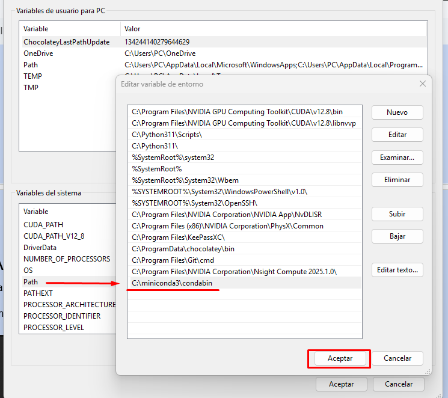

# Ejecutar conda

Ejecutado en la terminal

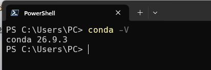
